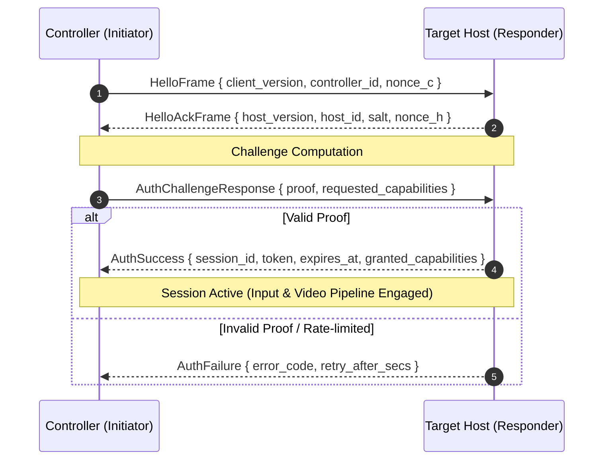

# MeshDesk Wire Protocol Specification

Version: `1.0.0`  
Transport: TCP / TLS (LAN), WebSocket (Signaling), WebRTC DataChannel (P2P / Relay)

---

## 1. Protocol Architecture & Framing

All MeshDesk network messages are strictly versioned, length-prefixed, and encoded in compact binary or validated JSON structures.

### 1.1 Binary Frame Format (TCP Transport)
```
+---------------+---------------+-------------------------------+
| Magic (4B)    | Version (2B)  | Message Length (4B, Big-Endian)|
| 0x4D 44 53 4B | 0x00 0x01     | uint32_t (Max: 65,536 bytes)   |
+---------------+---------------+-------------------------------+
| Payload Type  | Payload Data ...                              |
| (1B)          | (Serialized Protocol Message)                 |
+---------------+-----------------------------------------------+
```
- **Magic Bytes**: `0x4D44534B` (`MDSK`)
- **Version**: Major / Minor version tag (`0x0001` = v1.0)
- **Max Message Size**: Bounded to 65,536 bytes (64 KB) to eliminate memory exhaustion vectors.

---

## 2. Handshake & Authentication Flow



### 2.2 Protocol Message Types

#### `HelloFrame` (Client -> Host)
```json
{
  "type": "hello",
  "protocol_version": "1.0.0",
  "client_device_id": "MD-8491-2041",
  "client_public_key": "base64-encoded-ed25519-pubkey",
  "nonce": "random-16-bytes-hex",
  "timestamp": 1729680000
}
```

#### `HelloAckFrame` (Host -> Client)
```json
{
  "type": "hello_ack",
  "protocol_version": "1.0.0",
  "host_device_id": "MD-1920-5821",
  "host_name": "DESKTOP-ENGINEERING",
  "salt": "base64-salt-16-bytes",
  "nonce": "random-16-bytes-hex",
  "auth_method": "challenge_response_argon2id"
}
```

#### `AuthChallengeResponse` (Client -> Host)
```json
{
  "type": "auth_response",
  "session_request_id": "uuid-v4",
  "auth_proof": "base64-hmac-digest",
  "desired_permissions": ["view", "control"]
}
```

#### `AuthSuccess` (Host -> Client)
```json
{
  "type": "auth_success",
  "session_id": "sess-90214",
  "session_token": "token-hex",
  "expires_in_seconds": 3600,
  "granted_permissions": ["view", "control"],
  "display_info": {
    "width": 1920,
    "height": 1080,
    "dpi": 96
  }
}
```

#### `AuthFailure` (Host -> Client)
```json
{
  "type": "auth_failure",
  "code": "INVALID_CREDENTIALS",
  "message": "Authentication challenge failed. Verify device password.",
  "retry_after_secs": 5
}
```

---

## 3. LAN Discovery Protocol (UDP Broadcast)

- **Port**: Default `48121` UDP.
- **Broadcast Address**: `255.255.255.255` or local subnet broadcast.
- **Announcement Frame**:
```json
{
  "protocol": "meshdesk-discovery",
  "version": "1.0",
  "device_id": "MD-1920-5821",
  "device_name": "DESKTOP-ENGINEERING",
  "os": "Windows 11 x64",
  "listen_port": 48120,
  "allow_discovery": true,
  "status": "online"
}
```
*Note: The user can disable LAN announcement at any time in Settings, silencing UDP broadcasts.*

---

## 4. Input Injection Frame Format

For low-latency interactive control during active sessions:

```json
{
  "type": "input_event",
  "session_id": "sess-90214",
  "seq": 1042,
  "event": {
    "kind": "mouse_move",
    "x_normalized": 0.4521,
    "y_normalized": 0.7812
  }
}
```
Mouse coordinates are normalized between $0.0$ and $1.0$ to ensure precise mapping across disparate monitor resolutions and scaling factors.
